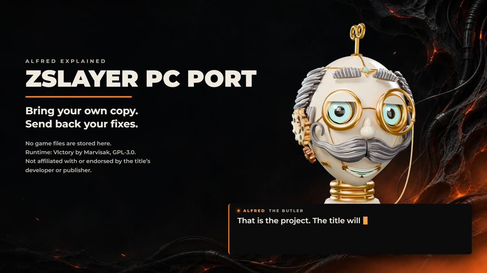

<div align="center">

# VIctory-ALFRED

<p align="center"></p>

**A console title, running natively on a Windows PC, from your own copy of it.**

[](LICENSE)


Open source · built live on stream · no part of any game is stored here

[What it is](#-what-this-is) · [Status](#-where-it-stands) · [Quick start](#-quick-start) · [In the game](#-in-the-game) · [Performance](#-performance) · [Roadmap](#-roadmap) · [Contributing](#-contributing) · [Credits](#-credits-and-licence)

</div>

---

## 🧭 What this is

VIctory-ALFRED gets one console game (called **"the title"** everywhere in this repository) running on a Windows PC
with a modern graphics card. It is a line of [VIctory](https://github.com/Marvisak/VIctory), an open-source
(GPL-3.0) runtime, built on two community lines of it, with our own work on top.

- **The title's own program runs directly on your processor.** The console and a PC share the x86-64 processor
  family, so its code needs no translation.
- **The runtime stands in for the console underneath it:** files, threads, memory, input, sound.
- **The console's graphics programs are translated** into DXIL, the shader format Direct3D 12 runs on a PC card.

**What it is not**

- Not an emulator of the whole console, and not a rewrite or a decompilation of the game.
- Not a copy of the game: you bring the title, from your own console, on your own disk. **This repository holds none
  of it**: no assets, no executable, no shader dumps, no screenshots, no captures.
- Not online: the runtime is offline by design, with no online play and no network features.
- Not a way past the console's protections: it runs a copy you have already made yourself.

> The project is not affiliated with or endorsed by the title's developer or publisher, nor by NVIDIA.

## 📊 Where it stands

In development: it reaches the open world and stays there, short of its frame-rate target and with known picture
faults. Measured on 2026-11-28 on an NVIDIA RTX 5090, at the larger console's profile and its 4K picture.

| | Feature | Today |
|:-:|---|---|
| ✅ | Start the title and reach the open world | works, and stays there |
| ✅ | Shader translation | about 222 of the title's roughly 25,800 programs still do not translate; the test scene uses one of them |
| ✅ | F1 settings menu, FPS counter, F3 performance overlay, stats in the window's title bar | works ([In the game](#-in-the-game)) |
| ✅ | Shaders prepared ahead of time (`victory preload`, or the menu's *Precompile shaders*) | works |
| 🟡 | Frame time | about 40 to 45 ms (22 to 25 fps) against a 33 ms (30 fps) target |
| 🟡 | Picture | grain on shadow, hair and beard edges; red blocks at the bottom and right edges; distant characters' heads ([KNOWN-FAULTS.md](KNOWN-FAULTS.md)) |
| 🟡 | Interior light | a stand-in by default; the title's own ray-traced bounce light works behind a switch and costs about 12 ms a frame |
| 🟡 | Water's own lighting | off by default: on, it still draws dark blocks |
| ⬜ | Ray tracing on the card's ray-tracing hardware | not yet: the title's rays run as ordinary compute work |
| ⬜ | DLSS, frame generation, the 1440p output mode | coming to the public build; not in this copy (see below) |
| ⬜ | Video memory on smaller cards | not yet measured on this base; the goal is to fit 12 GB cards |
| ⬜ | Cards other than the RTX 5090 | untested ([Graphics cards](#graphics-cards)) |

**Not in this copy yet: DLSS, frame generation and the 1440p output mode.** They work by changing the title's own
code, and the files that do that are not published here; small stand-ins that do nothing keep the rest building.
The settings menu shows their rows marked *(not in this build)*. They are coming to the public build.

<details>
<summary><b>Being worked on now</b></summary>

- **Speed:** most of a frame goes to one thread that prepares the title's work for the card; spreading and cutting
  that work is the main speed task.
- **Shaders:** the last programs that do not translate, so that none is refused.
- **Picture:** the grain, the red blocks at the screen's edge, flat facets on curved surfaces in shade, glossy
  surfaces that flicker indoors, and blank letters in the loading-screen tips. Fixes for several of these are built
  and being checked in play.
- **Memory:** a lock that the runtime's memory guards wait on, and the copies between the memory the title shares
  with its GPU and the card's own.
- **DLSS and frame generation** in the public build.

The full list of what is wrong, and what is known of each cause, is in [KNOWN-FAULTS.md](KNOWN-FAULTS.md).

</details>

## ⚙️ How it works

```
  the title's own code          runs as it is, on your processor
          │
  platform layer                files, threads, memory, input, sound: what the console provided
          │
  graphics translation          the console's GPU programs become DXIL; its commands become Direct3D 12
          │
  host renderer                 descriptors, memory copies, pipelines, pacing
          │
  your graphics card
```

The hard parts, in the order they cost us time:

1. **Shader translation.** The console's GPU runs its programs 64 lanes at a time; NVIDIA cards run 32. Programs
   that share work across all 64 have to be translated so that both halves still agree.
2. **Shared memory.** On the console the processor and the GPU see the same memory. On a PC they do not, so the
   runtime keeps the two sides in step and pays for it in copies and waiting.
3. **Ray tracing.** The title traces its own rays in compute programs. Moving that onto the card's ray-tracing
   hardware is the largest speed-up still open.

The runtime's parts are described in [victory/docs/architecture.md](victory/docs/architecture.md).

## 🚀 Quick start

### Requirements

| | |
|---|---|
| **System** | Windows 11, x64. Windows 10 needs Microsoft's newer Direct3D 12 runtime (the Agility SDK's `D3D12Core.dll` in a `D3D12` folder beside `victory.exe`), because the translated shaders need shader model 6.6; a start without it says so |
| **Processor** | x86-64 with AVX2 (the runtime refuses to start without it) |
| **Memory and disk** | 32 GB of RAM or more; an SSD |
| **Graphics** | a Direct3D 12 card with shader model 6.6 and a recent driver. Developed and measured on an NVIDIA RTX 5090; other cards are untested |
| **To build** | [Rust](https://rustup.rs) (the toolchain is pinned in [`victory/rust-toolchain.toml`](victory/rust-toolchain.toml) and installs itself on the first cargo call), and the Visual Studio Build Tools with "Desktop development with C++" |
| **The title** | your own copy, taken from your own console: the folder with its `MicrosoftGame.config` and the executable it names |
| **For measured runs** (optional) | Git Bash, Node.js and PresentMon, for the [harness](harness/README.md) |

### Build and run

Clone this repository, then in its `victory` folder:

```powershell
cargo build --profile diag -p victory --features diagnostics --locked
copy victory.example.toml victory.toml        # then set game_dir to your own copy of the title
cargo run -p victory --locked -- config       # shows the resolved configuration and checks it
target\diag\victory.exe play "<path to the title's executable>"
```

- `victory.exe` copied into the title's folder starts it with a double click: with no command it plays the title
  that the folder's `MicrosoftGame.config` names.
- Settings the menu saves, logs, caches and saves are kept under `%LOCALAPPDATA%\victory`; set `VICTORY_HOME` to
  keep them in another folder.
- **The first start of a new build is slower** while its shaders and pipelines are prepared. `victory preload`, or
  the menu's *Precompile shaders*, does that work up front; it is needed again after an update or a new driver.

<details>
<summary><b><code>victory play</code> options</b></summary>

| Option | What it does |
|---|---|
| *(none)* | the larger console's profile, the stock 3840 x 2160 output, no frame-rate cap |
| `--series-s` | the smaller console's profile (lower detail, faster). Not a way to reach the project's target |
| `--fps 30` / `60` / `120` | a frame-rate cap (30 is the console's own) |
| `--preload` | prepare every shader before the title starts |
| `--set VICTORY_X=1` | add or override any switch |

`--res`, `--dlss`, `--framegen` and `--fg-type` belong to the parts this copy leaves out: a start here says so and
goes on with the stock output and the title's own upscaling. What the F1 menu saved goes over these options at every
start.

</details>

For a **measured run** (it starts the runtime with the settings this line is measured with, records the window and
writes a summary), set `GAME_EXE` in `harness/local.env` (from `harness/local.env.example`), then from the
repository root in Git Bash: `harness/run-world.sh --tag first`. [harness/README.md](harness/README.md) has the
flags, and [victory/README.md](victory/README.md) the build, the configuration and the tests.

## 🎮 In the game

| Key or place | What it shows |
|---|---|
| **F1** | the settings menu (below) |
| **FPS counter**, top-left | the frame rate, and *PREPARING SHADERS (n left)* or *SHADERS READY* while shaders are being made |
| **F3** | the performance overlay: frame time, CPU and GPU timings and draw calls, for troubleshooting |
| **The window's title bar** | the build's name and commit, fps and ms a frame, GPU and CPU share, memory and video memory, draws a frame, the time spent preparing and waiting, and the card, its memory and driver, so that a screenshot says what it was measured on (`VICTORY_CAPTION_STATS=0` turns it off) |

### The F1 settings menu

**Up / Down** move · **Left / Right** change · **Enter** selects · **F1** or **Esc** closes.

Each row has a help line, and *(recommended)* marks the default choice. A change marked **Live** applies at once;
the others apply after a restart. Saved settings apply at the next start. The menu saves when the title was started
with `victory play` (or the harness's `--menu-file`). The panel is drawn from a `menu-art` folder beside the
executable, which `harness/snapshot-build.sh` copies from [`scripts/overlay-art/`](scripts/overlay-art/); without
it, or with `VICTORY_MENU_PANEL=0`, the menu is plain text.

<details>
<summary><b>Every row of the menu</b></summary>

| Group | Rows |
|---|---|
| **Graphics** | Resolution (only 3840 x 2160 in this build) · Console profile · Borderless fullscreen · DLSS upscaling and DLSS model preset *(not in this build)* |
| **Frame rate** | FPS limit (Unlimited, 120, 60, 30) · Frame generation, Frame gen type and MFG unlocker *(not in this build)* |
| **Lighting and water** | Real bounce light (the title's own ray-traced light; about a quarter of the frame rate today) · Ambient light fallback · Reflection fallback · Fog brightness clamp · Ray tracing: full BVH (experimental: a few frames a second) · Water lighting (dark blocks for now) · Heat haze and decal defrag (skipped by default: expensive for now) |
| **Overlay** | FPS counter · Performance overlay (F3), both live |
| **Input** | Lock cursor to window · Force English keyboard layout |
| **Advanced** | Early depth test · Skip large GPU readbacks · Soft views (no hitch at cuts) · Async texture uploads · Command relay · GPU-side copies · Draw call batching · Compare on the card from. Leave these alone unless a task asks |
| **Actions** | Apply and restart · Save (applies at next launch) · Precompile shaders (restarts the game) · Reset to defaults · Close |

</details>

<details>
<summary><b>Switches a first reader meets</b></summary>

Every switch is an environment variable named `VICTORY_…`, described in the source where it is read.

| Switch | What it does |
|---|---|
| `VICTORY_RT_RESOLVE=1` with `VICTORY_ACTIVATE_RAYS=1` | the title's own ray-traced light instead of the stand-in (about 12 ms a frame more) |
| `VICTORY_WATER_LIGHT=1` | the water's own tiled lighting (still draws dark blocks) |
| `VICTORY_STRICT_HALVES=1` | refuse the 64-lane programs that have only an approximate form on 32-lane cards |
| `VICTORY_WAVE_WIDE=1` | an exact last-resort form for those programs: slower, and it can hang the card |
| `VICTORY_FPS_LINE=0` / `VICTORY_PANEL=1` | the FPS counter off / the F3 overlay on |
| `VICTORY_MENU_PANEL=0` | the settings menu as plain text |
| `VICTORY_HOME=<folder>` | settings, saves, caches and logs in that folder instead of `%LOCALAPPDATA%\victory` |

</details>

## ⏱️ Performance

All figures: NVIDIA RTX 5090 (32 GB), the larger console's profile, 3840 x 2160, the open world, measured with
PresentMon on 2026-11-28.

| What | Median / p95 frame time |
|---|---|
| This public tree, one warm run | 45.9 / 93.6 ms |
| The base, across that day's runs | about 40 to 45 ms (22 to 25 fps) |
| With the title's ray-traced light on | about 54 to 56 ms |
| **Target** | **33 ms median, 50 ms p95 (30 fps), then 16.7 ms (60 fps)** |

In those runs the frame time hardly changed with resolution: the limit is one processor thread that prepares the
title's work for the card, not the card.

<details>
<summary><b>How we measure</b></summary>

A number only counts if an established tool produced it. Ours are glue around them, never the judge.

| Question | Tool |
|---|---|
| How long is a frame? | PresentMon |
| Where does the card's time go? | NVIDIA Nsight GPU Trace, PIX |
| Where does a thread's time go, and what is it waiting on? | Windows Performance Recorder, Tracy |
| Did the picture change? | ffmpeg's comparison filters on recorded frames |
| What did the card crash on? | DRED breadcrumbs (Direct3D 12's own crash trail) |

Every result names the card, its video memory and the driver it was measured on. Details are in
[docs/DIAGNOSTICS.md](docs/DIAGNOSTICS.md).

</details>

### Graphics cards

| Card | State |
|---|---|
| NVIDIA RTX 5090 (32 GB) | The development card. Every figure in this README was measured on it |
| NVIDIA RTX 40 and 30 series | Untested. The shaders translate the same way; **video memory is the open question** on 8 to 16 GB cards |
| AMD Radeon | The runtime's upstream runs on AMD; this line's NVIDIA-specific fixes switch themselves off there. Untested by us |
| Intel Arc | Untested |

If you have one of the untested cards, a run and its results sheet are the most useful thing you can send.
[CONTRIBUTING.md](CONTRIBUTING.md) says how ("Results from another GPU").

## 🗺️ Roadmap

1. **A correct picture.** Fix the grain, the blocks at the screen's edge, and the faults that show when the title's
   own ray-traced light is switched on.
2. **DLSS, frame generation and the 1440p mode** in the public build.
3. **30 frames a second on the development card.** Cut the work on the one preparing thread and the waiting
   between the processor and the card, and move the ray work onto ray-tracing hardware.
4. **Smaller cards.** Make memory use follow the card's budget so that 12 GB cards can run it.
5. **60 frames a second.**

The target is the larger console's profile at 1440p or 4K native, or upscaled to 4K from 1080p or 1440p. A lowered
render resolution and the smaller console's profile are not ways to reach it.

## 📁 What is in this repository

| Folder | What it is |
|---|---|
| [`victory/`](victory/) | The runtime, in Rust: it runs the title and translates its graphics ([victory/README.md](victory/README.md)) |
| [`harness/`](harness/) | The test harness: starts a run, records it, measures it with PresentMon, compares two runs, and summarises the log |
| [`docs/`](docs/) | How we measure ([DIAGNOSTICS.md](docs/DIAGNOSTICS.md)) and the explainer picture |
| [`scripts/overlay-art/`](scripts/overlay-art/) | The settings menu's panel art, and the Blender script that makes it |
| [`TASKS.md`](TASKS.md) and [`issues/`](issues/) | The task list, one page per task, and how to claim one |
| [`KNOWN-FAULTS.md`](KNOWN-FAULTS.md) | Every known fault, with what causes it where that is known |
| [`AGENTS.md`](AGENTS.md), [`CONTRIBUTING.md`](CONTRIBUTING.md) | The rules every contributor works by, person or AI agent |

## 🤝 Contributing

Work is claimed, done and checked in through issues: start at [TASKS.md](TASKS.md), and read
[KNOWN-FAULTS.md](KNOWN-FAULTS.md) before reporting something as new.

- **One task, one pull request**, with a test that fails before the change and passes after it.
- **New behaviour sits behind a switch that is off by default**, and off means off: the default path is unchanged.
- **Nothing from the title is ever committed**: no assets, no code listings, no shader dumps, no captures. Names of
  shaders and passes are fine ([the asset policy](victory/docs/asset-policy.md)).
- **Never name the title, its developer or its publisher** in code, comments, issues or commit messages.
- **Results name their card**, and a speed claim names the tool that measured it.

**What happens to a pull request.** It is read in full before anything is built, then built and tested by the
repository's checks, and a risky change (shader translation, the memory model, anything on by default that changes
the picture) is reviewed by a second AI model family before it merges. An accepted change is taken into the main
line as the maintainers' commit, with you credited, and the task is closed then.

The full rules, including the model requirement for AI agents, are in [AGENTS.md](AGENTS.md) and
[CONTRIBUTING.md](CONTRIBUTING.md). They apply the same to people and to agents; most of this project is built by
agents, in the open, on stream.

## 📜 Credits and licence

The runtime descends from [VIctory](https://github.com/Marvisak/VIctory) by Marvisak and its contributors, by way of
two community lines that made it much faster: foxhound, and VIctory-NVIDIA, the base this repository's runtime
starts from. What came from each, with links, and what is ours on top (the window's stats, the settings menu's
plain-language names and panel, translator fixes with their tests, and the test harness) are in
[THIRD-PARTY.md](THIRD-PARTY.md) and in the runtime's own notes.

Everything here is released under the [GNU General Public License v3.0](LICENSE).

Alfred, the butler above, keeps the house in order.

## ⚖️ Legal

- **Bring your own legally made copy** of the title, from your own console. This repository and its releases contain
  no game files, and none are accepted.
- The project does not break console encryption, and has no online features.
- NVIDIA, DLSS and other names are their owners' trademarks. The project is not affiliated with or endorsed by the
  title's developer or publisher, nor by NVIDIA.
